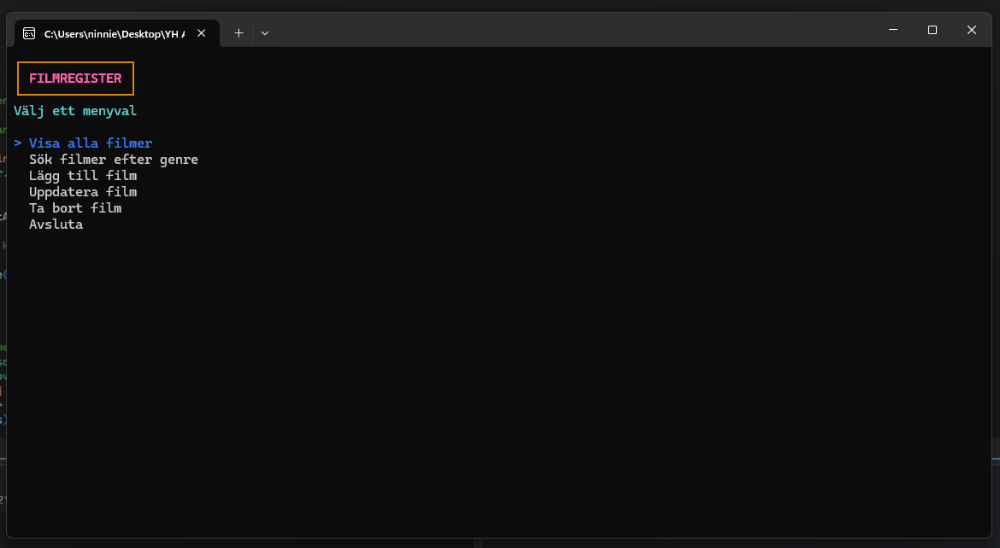

# 🎬 Filmregister – ADO.NET Console Application  
Individuell inlämningsuppgift – Programmering med C# .NET (40 YH‑poäng)  
Systemutvecklare .NET – Systementor AB



## 📌 Syfte
Detta projekt är en individuell examination där målet är att skapa en C#‑konsolapplikation som kopplar mot en SQL Server‑databas med hjälp av **ADO.NET**.  
Applikationen hanterar ett enkelt filmregister där filmer och genrer lagras i två relaterade tabeller.

Projektet demonstrerar:
- databaskoppling med ADO.NET  
- läsning, sökning, skapande och borttagning av data  
- parametriserade SQL‑frågor  
- korrekt hantering av anslutningar  
- separering av UI och dataåtkomst (Repository‑mönster)

---

## 🗂️ Funktionalitet
Applikationen uppfyller samtliga krav för betyget **Godkänt**:

### ✔ Visa alla filmer  
Hämtar alla filmer och visar titel, år och genre.

### ✔ Sök filmer efter genre  
Användaren väljer en genre och får en lista med alla filmer som tillhör den.

### ✔ Lägg till film  
Användaren anger titel, år och väljer en befintlig genre.  
Validering säkerställer att titel inte är tom och att år är rimligt.

### ✔ Ta bort film  
Användaren väljer en film ur listan och tar bort den.

### ✔ Parametriserade SQL‑frågor  
Alla SQL‑kommandon använder `SqlParameter` för att undvika SQL‑injektion.

### ✔ Korrekt hantering av anslutningar  
`SqlConnection` öppnas och stängs korrekt i repository‑klasserna.

### ✔ Separering av lager  
- **MenuUI** – användargränssnitt  
- **MovieRepository** – dataåtkomst för filmer  
- **GenreRepository** – dataåtkomst för genrer  
- **Models** – datamodeller

---

## 🛠️ Tekniker och verktyg
- **C# .NET**  
- **ADO.NET**  
- **SQL Server**  
- **SqlConnection, SqlCommand, SqlDataReader, SqlParameter**  
- **Repository‑mönster**  
- **Spectre.Console** (för ett tydligare och mer användarvänligt konsol‑UI)

---

## 🗄️ Databasstruktur

### Tabell: Genre
| Kolumn      | Typ        |
|-------------|------------|
| GenreId     | int (PK)   |
| GenreName   | nvarchar   |

### Tabell: Movie
| Kolumn      | Typ        |
|-------------|------------|
| MovieId     | int (PK)   |
| Title       | nvarchar   |
| Year        | int        |
| GenreId     | int (FK → Genre.GenreId) |

Relation:  
**En genre kan ha flera filmer. En film tillhör exakt en genre.**

---

## 🔌 Connection String
Justera connection string i `MovieRepository` och `GenreRepository` så den matchar din lokala SQL Server‑instans:

```csharp
Server=.;Database=MovieRegisterDB;Trusted_Connection=True;
